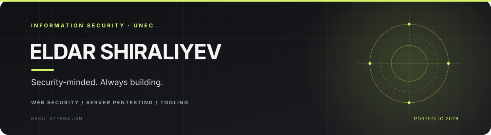

  

  
  
  

---

<table>
<tr>
<td width="62%" valign="top">

## Hey, I'm Eldar.

**Information Security student @ UNEC · Azerbaijan**

I’m a second-year Information Security student interested in understanding how systems behave, where security boundaries fail, and how to turn that understanding into useful tools.

My current focus is **web application security, server penetration testing, Linux, and networking**. I enjoy exploring security concepts in authorized environments, building small tools, and documenting findings so they are easier to reproduce and understand.

- `01` — Learn the underlying technology before testing it
- `02` — Validate behavior instead of trusting scanner output
- `03` — Build practical tooling and keep improving it
- `04` — Write clear, reproducible technical documentation

</td>
<td width="38%" valign="top">

### CURRENT FOCUS

### PRINCIPLES
- **Curiosity over assumptions**
- **Evidence over noise**
- **Impact over vanity metrics**
- **Responsible testing by default**

</td>
</tr>
</table>

## Selected work

<!-- PINNED_PROJECTS_START -->

<table>
<tr>
<td width="100%" valign="top">

<h3><a href="https://github.com/eldarshiraliyev/BugScanner">BugScanner ↗</a></h3>

🐛 Advanced web vulnerability scanner with 5-rule false-positive reduction, WAF evasion, and modern HTML reports

  
  &nbsp; <strong>★</strong> 103
  &nbsp; <strong>⑂</strong> 14

<code>asyncio</code> &nbsp; <code>attack-surface</code> &nbsp; <code>bug-bounty</code>

</td>
</tr>
</table>

<!-- PINNED_PROJECTS_END -->

Pin or unpin repositories on your GitHub profile; this section syncs automatically.

## What I work with

<table>
<tr>
<td width="50%" valign="top">

### Security & systems

**Areas of interest**
- Web application testing
- Broken access control and authorization logic
- HTTP security headers, CORS, and cookies
- Linux security fundamentals and server configuration
- Networking, protocols, ports, and request flows

</td>
<td width="50%" valign="top">

### Web & backend

**Tools & technologies**
- Python for security utilities and automation
- HTML and browser-facing web fundamentals
- Supabase and database-backed application basics
- Git and GitHub for version control and documentation
- Markdown for structured technical reporting

</td>
</tr>
</table>

<strong>Current skill map — areas I’m actively developing</strong>

| Area | Current learning / practice focus |
|:--|:--|
| Linux | Shell, users and groups, file permissions, services, and security fundamentals |
| Networking | TCP/IP, DNS, common protocols and ports, HTTP/S |
| Web security | Request/response behavior, access control, CORS, headers, cookies |
| Web pentesting | Methodical testing, evidence collection, reproducible findings |
| Server pentesting | Service and configuration review in authorized labs and scoped environments |
| Python | Small security tools, automation, parsing, and reporting |
| Supabase | Backend fundamentals, database concepts, and application data flows |

*This is a snapshot of an ongoing learning journey, not a claim of mastery in every area.*

## GitHub activity

  

  

   
  

  

Statistics and contribution visuals are powered by third-party services and may occasionally be unavailable or delayed.

## Beyond the code

| LEARN | BUILD | SHARE |
|:--:|:--:|:--:|
| Strengthen fundamentals | Create practical security utilities | Document reproducible results |
| Study how systems work | Improve signal-to-noise ratio | Learn from feedback |

I’m working toward becoming a stronger security practitioner by combining foundational knowledge with hands-on experimentation, thoughtful tooling, and responsible testing.

## Let’s connect

Interested in security research, useful developer tools, and learning from people who care about understanding systems deeply.

  
  

    
  BAKU, AZERBAIJAN · LEARN WITH INTENT. BUILD WITH PURPOSE.
    
  

